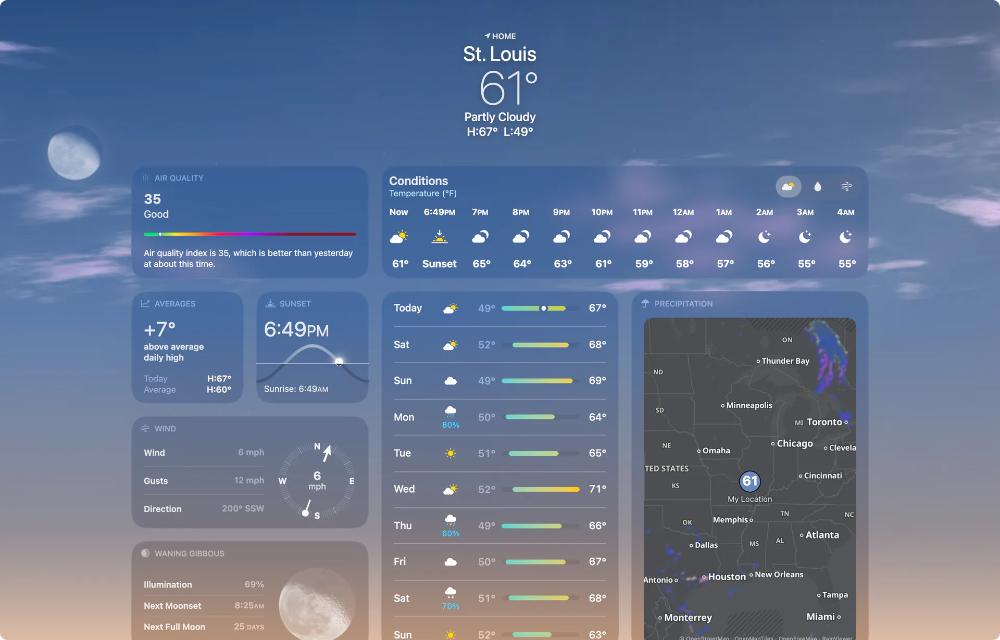
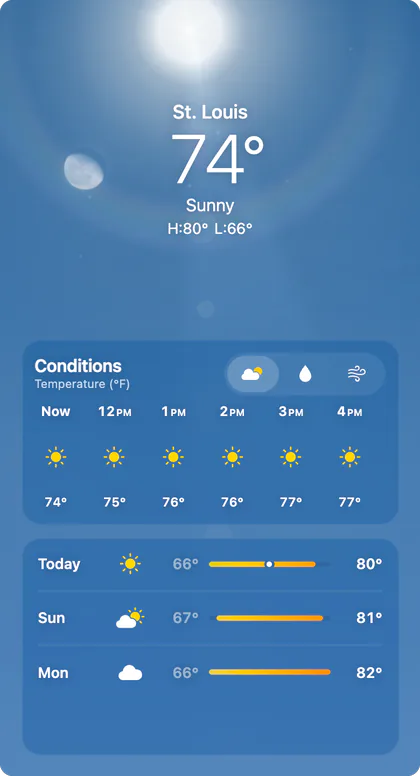
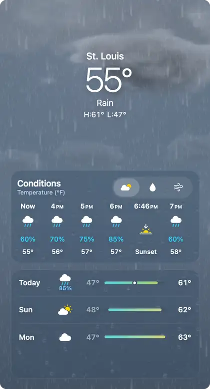
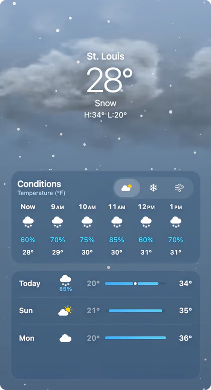
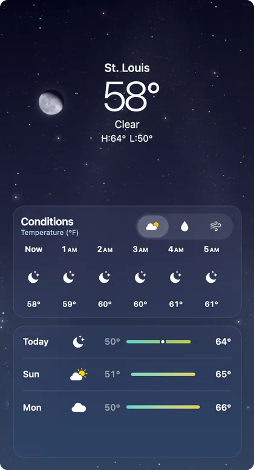
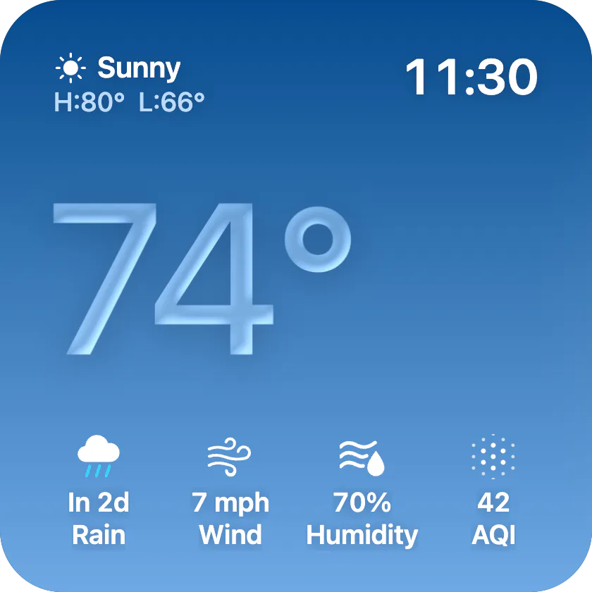
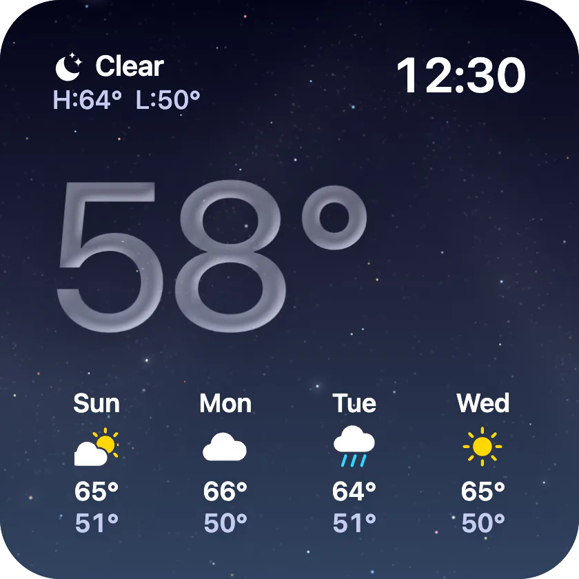
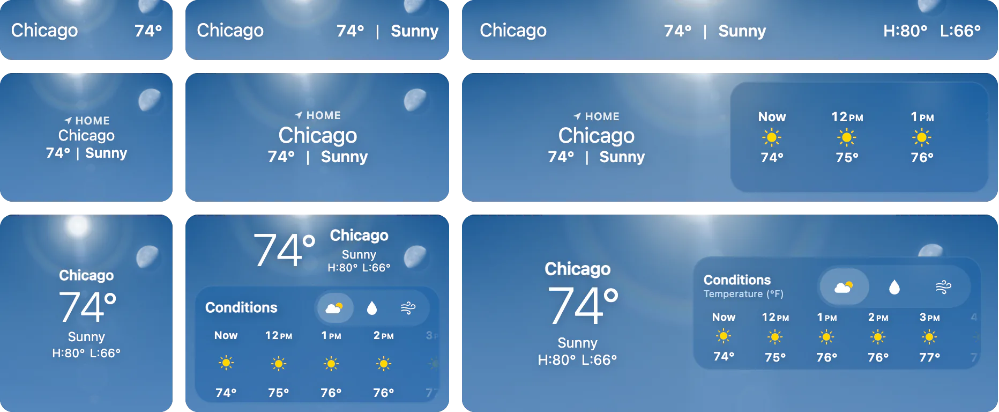

<div align="center">

# iWeather Card

See the weather now, hour by hour and up to ten days ahead on your Home Assistant dashboard. The sky behind the readings changes with local conditions and the time of day.

[](../../releases/latest)
[](#hacs)
[](https://www.home-assistant.io)
[](#what-leaves-your-browser)
[](tsconfig.base.json)
[](e2e)

[Try the demo](https://sitapix.github.io/iweather-card/) · [Install](#install) · [Add to a dashboard](#use) · [Layouts](#layouts) · [Examples](docs/examples.md) · [Privacy](#what-leaves-your-browser) · [All options](docs/configuration.md)



</div>

## Features

- **Watch the sky change.** Clouds, fog, rain, snow and lightning follow the reported weather. After dark, the sky can show stars and the moon in its current phase.
- **Follow the forecast.** Switch the hourly view between conditions, precipitation and wind. Sunrise and sunset appear between hours. Compare up to ten days of highs and lows on a shared scale.
- **See what’s on the way.** Full page can show active weather alerts and a minute-by-minute precipitation forecast. Its optional map shows radar and up to 12 hours of forecast precipitation. Diagonal shading marks places without precipitation data.
- **Look closer at a reading.** Tap a tile for details. Wind has a compass and gust speeds, the moon has a calendar of phases, and pressure shows whether it’s rising or falling. On charts with a time slider, use the arrow keys to move between readings or Home and End to jump to either end.
- **Use your own weather station.** Choose any Home Assistant weather entity. Add a sensor for an individual reading or a second weather entity for missing forecasts.

<p align="center">
  
  
  
  
</p>

## Install

You’ll need Home Assistant 2023.9.3 or later and a weather entity.

### HACS

[](https://my.home-assistant.io/redirect/hacs_repository/?owner=sitapix&repository=iweather-card&category=plugin)

Open the repository with the button above, install **iWeather Card**, then reload your browser.

To add the repository yourself, open the ⋮ menu in HACS and select **Custom repositories**. Enter `https://github.com/sitapix/iweather-card`, choose **Dashboard**, and add the repository. You can then install the card in HACS.

### Manual

1. Download all the card files attached to the [latest release](../../releases/latest). To build them yourself, use Node.js 22.18 or later and pnpm, then run `pnpm install --frozen-lockfile` and `pnpm build`. The build writes the files to `dist/`.
2. Copy all the files into one folder, such as `/config/www/iweather/`. The card looks there for its images, map and translations.
3. In **Settings → Dashboards → ⋮ → Resources**, add `/local/iweather/iweather-card.js` as a **JavaScript module**. Reload your browser.

When you update a manual installation, copy the new files and change the version in the resource URL, for example to `/local/iweather/iweather-card.js?v=2`. The other assets get new filenames when their contents change.

## Use

Edit your dashboard, select **Add card**, then choose **iWeather**. The picker starts with **Full page** and suggests a weather entity, preferring one that supplies forecasts. Check the entity and save. In Home Assistant 2026.6 or later, the picker’s **By entity** tab also offers Full page, Forecast and Compact for a weather entity.

For YAML, replace `weather.home` with your entity ID. With no layout specified, the card uses **Automatic** and fits the space on your dashboard.

```yaml
type: custom:iweather-card
entity: weather.home
```

For a full page with radar and historical averages, use this configuration. Change the entity and town to match your forecast.

```yaml
type: custom:iweather-card
entity: weather.home
weather_layout: page
place_name: St. Louis
averages: open-meteo
map: rainviewer
```

**Data sources** in the editor lists readings your weather entity doesn’t provide. You can add sensors there as you need them.

### Layouts

| Editor layout | `weather_layout` | What you’ll see |
|---|---|---|
| Automatic | `auto` | Current conditions in a small space. More forecast detail appears as the card gets larger. |
| Compact | `compact` | A small tile with the location and temperature above the conditions and today’s high and low. |
| Strip | `strip` | Current weather on one line. Wider cards also show today’s high and low. |
| Home view | `homeview` | A large temperature and clock for a tablet or bedside display. Swipe the bottom row to switch between the next four days and current readings. Tap an item for details. |
| Expanded | `expanded` | Current conditions above the hourly and daily forecasts. Allow about 320 px of height for this layout. |
| Full page | `page` | Forecasts, alerts and up to 12 detail tiles in two to six columns. In a panel view, current conditions stay at the top as you scroll. |

**Quick setup** offers five presets. Compact, Home view, Expanded and Full page use their matching layouts, and **Home view** turns the glass temperature on. **Wall tablet** uses Full page with larger text and low-power animation. You can undo a preset until your next edit.

<p align="center">
  
  
</p>

In a Sections dashboard, resize Automatic from a one-row strip to a full section. In the editor preview and Masonry views, the default heights are 56 px for Strip, 180 px for Compact, 280 px for Automatic and 700 px for Expanded. Home view starts square. Compact starts at three rows in Sections. A dashboard grid size or `--iweather-height` overrides the default.

<p align="center">
  
</p>

### Common options

| Option | Default | What it controls |
|---|---|---|
| `entity` | Required | The `weather.*` entity for current conditions and forecasts. |
| `weather_layout` | `auto` | The [dashboard layout](#layouts). |
| `place_name` | None | The location label. Away from home, it also labels the map pin. |
| `zone` | Entity coordinates, then home | The location used for the sky, moon, map and online weather requests. |
| `tiles` | All 12 | Which Full page tiles to include and their order. A tile appears when it has data. |
| `air_quality_entity` | None | An AQI sensor. Without one, Full page can use Open-Meteo’s US AQI. |
| `air_quality_scale` | `auto` | The scale your sensor reports. Automatic checks its name for a match, such as AQHI or DAQI, and falls back to the US scale. |
| `alert_entities` | None | Sensors from NWS Alerts, Meteoalarm or another weather alert integration. With no sensors configured, Full page can fetch National Weather Service alerts in the US. |
| `next_hour_entity` | None | A weather entity or sensor with precipitation forecasts at intervals shorter than an hour, such as five-minute rain amounts. |
| `averages` | None | `open-meteo` for historical averages, or a temperature sensor with at least two years of long-term statistics. |
| `map` | None | `rainviewer` adds radar and weather across the map. `local` shows Home Assistant readings at your location. |
| `forecast_entity` | None | A second weather entity that fills gaps in forecasts and current readings. |
| `open_meteo_forecast` | `true` | Lets Full page request missing forecast data from Open-Meteo. |
| `local_only` | `false` | Turns off built-in online services. Custom map tile URLs can still receive requests. |
| `weather_animation` | `true` | Animates the sky when your device allows motion. |
| `glass_refraction` | `true` | Bends the sky through raindrops on panels or through the temperature digits in Home view. |

Home Assistant pushes entity and forecast changes to the card. **Map and online services → Refresh intervals** sets how often a visible card checks RainViewer for radar (1–60 minutes, default 5) and Open-Meteo for missing forecasts (15–360 minutes, default 60). Your integration sets its own update schedule. To see when a source last changed or when the card last fetched a forecast, open **Conditions → Data Updates**.

[Example configurations](docs/examples.md) · [All options and defaults](docs/configuration.md)

## Detail tiles

Tap a tile in the Full page layout to open its details. Use the IDs below in the `tiles` option to choose their order. Poor air quality, a feels-like temperature at least 5 °F (about 3 °C) from the measured temperature, or an unusual daily high can move the relevant tile toward the top.

| Tile | What it shows | Data source |
|---|---|---|
| `air_quality` | Index, category and comparison with yesterday when available | `air_quality_entity` or Open-Meteo |
| `wind` | Speed, direction and gusts on a compass | Wind speed, with direction and gusts when available |
| `moon` | Phase, next moonrise or moonset, and a calendar of phases | Calculated phase, with rise and set times for the forecast coordinates |
| `sun` | Next sunrise or sunset and the sun’s path | `sun.sun` at home, forecast coordinates for other locations |
| `uv` | UV index, risk level and sun protection guidance | UV index |
| `map` | Radar or forecast precipitation, wind, temperature or air quality | `map: rainviewer` or `map: local` |
| `feels_like` | How the temperature feels | Reported apparent temperature, or an estimate using the air temperature with humidity for heat index and wind speed for wind chill |
| `averages` | Today’s high relative to the usual high for this date, or recent precipitation compared with the average | `averages` |
| `precipitation` | Recent or expected precipitation and when rain or snow is next due | Forecast amounts or chances, with recent totals from a configured gauge |
| `visibility` | How far you can see and what may be limiting the view | Visibility |
| `humidity` | Relative humidity and dew point | Humidity, with dew point when available |
| `pressure` | Barometric pressure and its recent trend | Pressure, with history for the trend |

The map follows the hourly forecast view and local conditions. It can highlight approaching rain, poor air quality or wind on a dry, gusty day. Open the map to choose a layer yourself.

## What leaves your browser

Automatic, Compact, Strip, Home view and Expanded get their weather from Home Assistant. **Full page** can also contact the services below. The card needs no API key. Each service receives requests directly from your browser and can see its IP address.

**For a local dashboard**, set `local_only: true`. This turns off the built-in online services. To display a map in this mode, enable the map and set `map_tile_url`. The map requests that URL and any `map_layers` overlays you configure, so use local tile servers to keep those requests on your network.

| When Full page requests data | Service and purpose | Location in the request |
|---|---|---|
| Forecast values are missing and `open_meteo_forecast` is on | Open-Meteo fills gaps, by default every 60 minutes while the card is visible. | Forecast coordinates rounded to about 100 m, plus time zone |
| Air quality tile is enabled without an AQI sensor | Open-Meteo supplies current and previous-day AQI and pollutant readings, refreshed hourly. | Forecast coordinates rounded to about 100 m |
| No alert sensors are set, and the entity uses NWS or Home Assistant’s country is the US or a covered territory | The National Weather Service supplies active alerts, checked every five minutes while visible. | Forecast coordinates rounded to about 10 m |
| `averages: open-meteo` | Open-Meteo supplies 1991–2020 averages, cached in the browser, and the last 30 days of precipitation, refreshed every six hours. | Forecast coordinates rounded to about 100 m |
| Online map | RainViewer supplies radar and coverage. The card checks for new images every five minutes by default. | Map area |
| Online map, one-hour forecast in the contiguous US | The Iowa Environmental Mesonet serves NOAA HRRR simulated radar at 15-minute intervals. The open map checks for a new run every ten minutes. | Map area |
| Online map, 12-hour precipitation forecast | Regional sources include NOAA’s HRRR archive at the University of Utah for the contiguous US and MET Norway for the Nordic region. Environment and Climate Change Canada supplies regional and global models. Open-Meteo provides a fallback. | Map area |
| Online map, wind, temperature or air quality | Open-Meteo supplies weather across the map. Over the US, southern Canada and northern Mexico, AirNow supplies measured air quality. | Map area for Open-Meteo. AirNow serves the same coverage file for every location. |
| Base map tiles | The online map uses OpenFreeMap and OpenStreetMap. The local weather map uses OpenStreetMap by default. A custom `map_tile_url` selects your tile server. | Map area |
| Custom overlays | Servers you configure in `map_layers` supply overlay tiles. | Map area |

## Languages

The card and its editor follow your Home Assistant language. They support English, Chinese (Simplified and Traditional), Czech, Danish, Dutch, Finnish, French, German, Italian, Japanese, Korean, Norwegian Bokmål, Polish, Portuguese, Spanish and Swedish. Other languages use English.

## Support

Include your weather integration, layout and the reading or forecast you expected when you [report a bug](../../issues). For questions and ideas, visit [Discussions](../../discussions).

## Development

```sh
pnpm install --frozen-lockfile
pnpm dev     # Local demo and preview pages
pnpm check   # Type checks, lint, formatting, tests and production build
pnpm build   # Card and assets in dist/
pnpm demo    # Static demo and setup guide in _site/
```

With the dev server running, open [the demo](http://127.0.0.1:4174/demo/) to try sample weather or look up a live forecast. The [preview pages](http://127.0.0.1:4174/preview/) use sample scenes for development. Pushes to `main` publish the demo to [GitHub Pages](https://sitapix.github.io/iweather-card/).

- **Browser tests.** Before the first run, install the browsers with `pnpm exec playwright install chromium-headless-shell firefox webkit`.
- **Performance.** With the dev server running, `pnpm perf run` measures all 33 skies on desktop, phone and tablet by day and night. It uses your installed Chrome by default and writes timings, fixed-frame screenshots and accessibility snapshots to `perf-results/`. Run it separately from the browser tests so they don’t compete for the GPU. [Performance guide](docs/weather-performance-2026-11-03.md) · [Firefox rain](docs/firefox-rain-performance-2026-11-03.md) · [Firefox glass](docs/firefox-glass-copy-performance-2026-11-03.md) · [GPU rain](docs/gpu-rain-performance-2026-11-04.md)
- **Compression.** After building, `pnpm compress` creates gzip and Brotli copies of the scripts and styles for servers that support them. Regenerate these with each build so the server sends the current files.
- **Images.** Run `node scripts/clouds.ts` to regenerate cloud images with libavif’s `avifenc`. Run `node scripts/readme-images.ts` to regenerate the README images with Chrome, ffmpeg and the libwebp tools.
- **Releases.** Pushing a version tag creates a draft release and checks the attached files against the build. Review the draft before publishing it.

[Project glossary](docs/glossary.md) · [Design decisions](docs/adr)

## Credits

- **Moon imagery.** NASA’s Scientific Visualization Studio, using Lunar Reconnaissance Orbiter imagery. Public domain. [CGI Moon Kit](https://svs.gsfc.nasa.gov/4720)
- **Forecasts, air quality and climate averages.** The card credits Open-Meteo in the footer when it uses these data. CC BY 4.0. [Open-Meteo](https://open-meteo.com/)
- **US alerts.** National Weather Service, public domain. [NWS](https://www.weather.gov/)
- **Radar.** RainViewer, free for personal use with attribution. [RainViewer](https://www.rainviewer.com/)
- **Measured air quality.** AirNow, a service of the US Environmental Protection Agency and its partners. [AirNow](https://www.airnow.gov/)
- **Precipitation forecasts.** The map identifies the active model under **Map Data**. Sources include NOAA HRRR, MET Norway’s MEPS (CC BY 4.0) and Canadian regional and global models (Open Government Licence – Canada). [NOAA HRRR](https://registry.opendata.aws/noaa-hrrr-pds/) · [University of Utah HRRR archive](https://mesowest.utah.edu/html/hrrr/) · [Iowa Environmental Mesonet](https://mesonet.agron.iastate.edu/GIS/model.phtml) · [MET Norway](https://thredds.met.no/thredds/catalog/mepslatest/catalog.html) · [Environment and Climate Change Canada](https://eccc-msc.github.io/open-data/msc-geomet/readme_en/)
- **Maps.** © OpenStreetMap contributors, with OpenMapTiles and OpenFreeMap. The card ships MapLibre GL JS with its BSD 3-Clause license. [OpenStreetMap](https://www.openstreetmap.org/copyright) · [OpenMapTiles](https://openmaptiles.org/) · [OpenFreeMap](https://openfreemap.org/) · [MapLibre GL JS](https://maplibre.org/)

## License

[MIT License](LICENSE)
