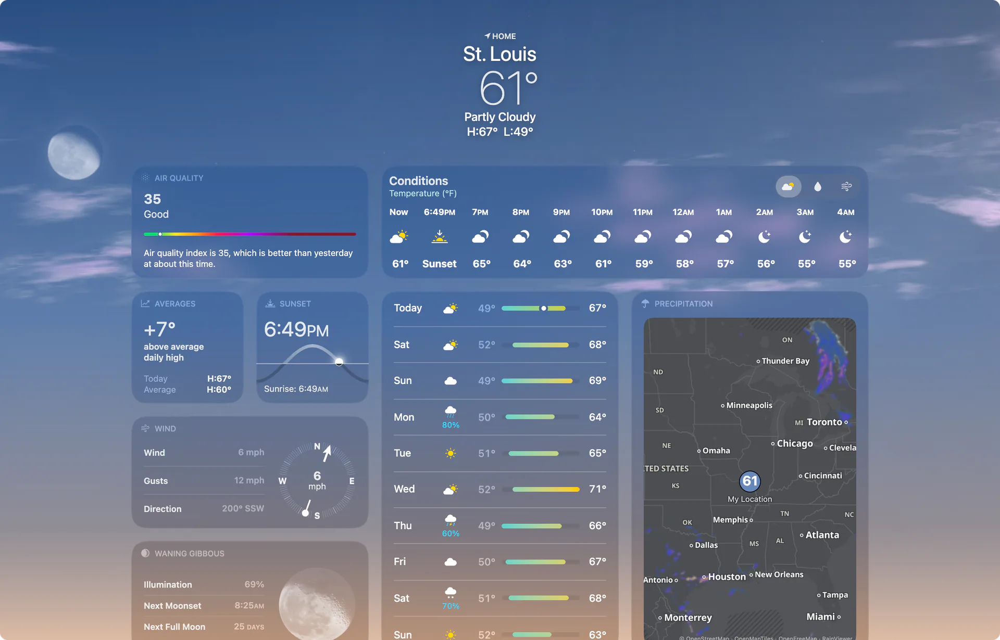
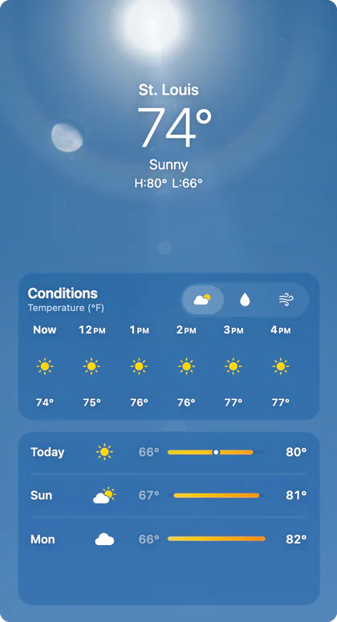
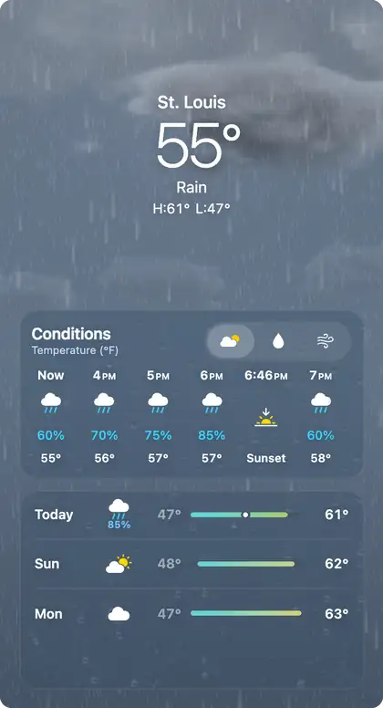
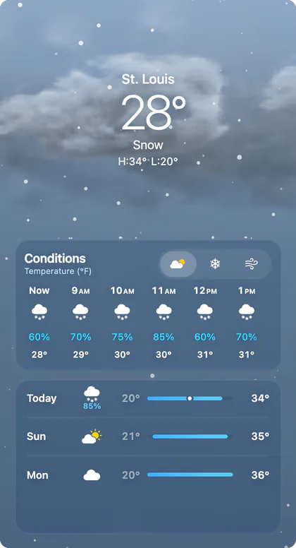
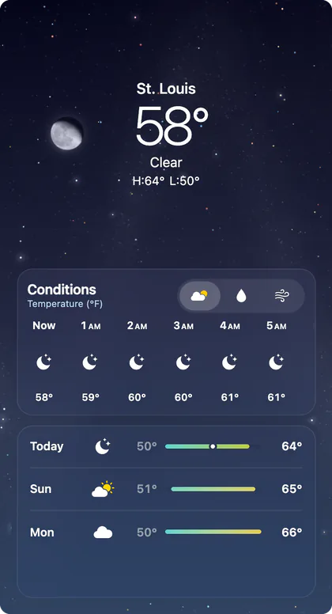
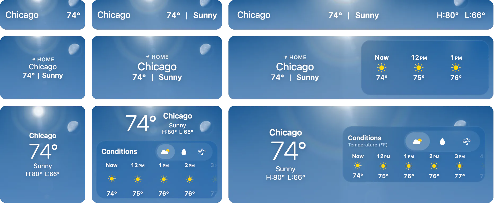

<div align="center">

# iWeather Card

A weather forecast card for [Home Assistant](https://www.home-assistant.io). Its background is an animated sky that matches your current weather and the time of day.

[](../../releases/latest)
[](#hacs)
[](https://www.home-assistant.io)
[](#what-leaves-your-browser)
[](tsconfig.base.json)
[](e2e)

[Features](#features) • [Install](#install) • [Use](#use) • [Examples](docs/examples.md) • [Tiles](#detail-tiles) • [Privacy](#what-leaves-your-browser) • [All options](docs/configuration.md)



</div>

## Features

- **Animated sky** with clouds, rain, snow, fog, lightning, stars and the moon in its current phase, drawn from your weather entity and the sun's position.
- **Hourly forecast** with Conditions, Precipitation and Wind views. Sunrise and sunset show between the hours.
- **Daily forecast** for up to 10 days, with each day's temperature range on one shared scale.
- **Full-page layout** with 12 detail tiles. Tap a tile for hourly charts, a comparison with yesterday and a short explanation of the reading. To inspect a chart with the keyboard, Tab to its time slider and use the arrow keys; Home and End jump to the first and last readings.
- **Weather map** with radar, a 12-hour precipitation forecast, wind, temperature and air quality. It shows precipitation when rain is falling or due soon, air quality when it's poor, and wind on a dry, gusty day. Where radar doesn't reach, it opens on the forecast. Diagonal shading marks areas with no precipitation data; dry areas stay clear.
- **Weather alerts and next-hour rain** from NWS Alerts, Meteoalarm or a nowcast integration. In the United States, the `page` layout shows National Weather Service alerts without any setup.
- **Works with any weather integration.** You can replace any reading with a sensor, or fill in missing readings from a second weather entity or Open-Meteo.
- **Any size**, from a one-row strip to a full screen.
- **Visual editor** for every option, with four presets and undo.

<p align="center">
  
  
  
  
</p>

## Install

### HACS

[](https://my.home-assistant.io/redirect/hacs_repository/?owner=sitapix&repository=iweather-card&category=plugin)

The button opens this repository in HACS on your own Home Assistant. Install **iWeather Card**, then reload your browser. To add it by hand instead:

1. In HACS, open the ⋮ menu and choose **Custom repositories**.
2. Add this repository's URL with the type **Dashboard**.
3. Install **iWeather Card**, then reload your browser.

### Manual

1. Download every file from the [latest release](../../releases/latest), or build them with Node 22.18 or newer and [pnpm](https://pnpm.io):

   ```sh
   pnpm install --frozen-lockfile
   pnpm build   # writes them to dist/
   ```

2. Copy them all to one folder, such as `/config/www/iweather/`. The card loads its cloud and moon images, the map and its translations from that folder, so keep the files together.
3. Go to **Settings → Dashboards → ⋮ → Resources** and add `/local/iweather/iweather-card.js` as a **JavaScript module**.

> [!TIP]
> Browsers keep using the cached file after an update. To load the new one, change the resource URL, for example to `/local/iweather/iweather-card.js?v=2`. Only the card's own file needs this: the other files get new names when they change.

## Use

Add **iWeather** from the card picker. It starts with the full-page layout and picks a weather entity for you, preferring one with forecasts. To switch to a compact tile, a forecast, a full page or a wall tablet, open **Quick setup** in the editor. It keeps your sources, units, privacy settings, actions and tiles, and you can **Undo** the switch until your next edit. In Home Assistant 2026.6 and later, picking a weather entity on the picker's **By entity** tab also offers the forecast and compact versions of the card.

In YAML, the entity is the only required option:

```yaml
type: custom:iweather-card
entity: weather.home
```

The full page needs a few more options to fill every tile:

```yaml
type: custom:iweather-card
entity: weather.home
weather_layout: page
place_name: St. Louis
air_quality_entity: sensor.air_quality_index
alert_entities:
  - binary_sensor.meteoalarm
averages: open-meteo
map: rainviewer
```

A tile with no data stays hidden, so you can start with the entity alone and add sources later. The editor's **Data sources** section shows which readings your entity doesn't provide.

> [!TIP]
> In a panel view, the `page` layout fills the screen. When you scroll, the current conditions shrink into a bar at the top and the panels scroll under it.

### Layouts

| `weather_layout` | Shows |
|---|---|
| `auto` | Picks a layout to fit the card's size. This is the default. |
| `compact` | A short tile with the location and temperature above the conditions and high/low, over the animated sky. |
| `strip` | A single line with the location, temperature and conditions, plus high/low on a wide card, over the animated sky. |
| `expanded` | The conditions, the hourly forecast and the daily list. Needs about 320 px of height. |
| `page` | Alerts, forecasts and detail tiles, in two to six columns. |

In the editor preview and masonry views, `strip` defaults to 56 px tall, `compact` to 180 px, `auto` to 280 px, and `expanded` to 700 px. Compact uses three rows in a sections dashboard and keeps the same layout at every size. Dashboard grid sizes and `--iweather-height` override those defaults.

In a sections dashboard, `auto` changes layout as you resize it, from a one-row strip to the whole section:

<p align="center">
  
</p>

### Common options

| Option | Default | Description |
|---|---|---|
| `entity` | required | Any `weather.*` entity |
| `weather_layout` | `auto` | `auto`, `compact`, `strip`, `expanded` or `page` |
| `place_name` | none | Your town or city, for the `page` layout |
| `zone` | home | The zone to show weather for, if not home. The sky, the map and Open-Meteo requests use its location. |
| `tiles` | all 12 | Which tiles the `page` layout shows, in order |
| `air_quality_entity` | none | A sensor with an air quality index. Without one, the `page` layout shows Open-Meteo's US index |
| `air_quality_scale` | `auto` | The scale that sensor reports on: `auto`, `us`, `at`, `ca`, `cn`, `de`, `es`, `eu`, `fr`, `ie`, `in`, `kr`, `mx`, `sg` or `uk`. `auto` guesses from the sensor's name, such as `aqhi` or `daqi`, and falls back to the US scale |
| `alert_entities` | none | Sensors with weather alerts. Without them, the `page` layout shows the National Weather Service's alerts in the United States |
| `next_hour_entity` | none | A nowcast weather entity or minute-by-minute sensor |
| `averages` | none | `open-meteo`, or a temperature sensor with two years of statistics |
| `map` | none | `rainviewer` for radar and wind across the map, `local` for your own data |
| `forecast_entity` | none | Another weather entity, to fill in what yours lacks |
| `open_meteo_forecast` | `true` | On the `page` layout, fill forecast gaps from Open-Meteo |
| `local_only` | `false` | Ask no outside service. See [What leaves your browser](#what-leaves-your-browser). |
| `weather_animation` | `true` | Animate the sky. Your system's reduce-motion setting also turns it off. |
| `glass_refraction` | `true` | Bend the sky through raindrops on the panels. Turned off, the drops and highlights stay but take less work to draw. |

[Examples](docs/examples.md) shows a few setups to start from. [All options](docs/configuration.md) covers units, sensors for each reading, the map's tiles and overlays, sizing, and how each panel behaves.

The card updates as soon as Home Assistant sends a new state or forecast. In the editor, **Map and online services → Refresh intervals** sets how often the card checks for new radar (1–60 minutes, default 5) and asks Open-Meteo for missing forecast values (15–360 minutes, default 60). Neither changes how often your weather integration polls or how often its provider takes readings. The Conditions sheet's **Data Updates** section shows how old each source's data is and when the card last fetched forecast values.

## Detail tiles

The `page` layout shows each of these tiles when it has the data for it. Tap a tile to open a sheet with more detail.

| Tile | Shows | Needs |
|---|---|---|
| `air_quality` | The index, its category, and how it compares with yesterday | `air_quality_entity` |
| `wind` | Compass with speed, direction and gusts | `wind_speed` |
| `moon` | Phase, next moonrise or moonset | Home Assistant's location |
| `sun` | Next sunset or sunrise, and the sun's path | `sun.sun` |
| `uv` | UV index, level, and when to use sun protection | `uv_index` |
| `map` | Radar, wind, temperature or air quality, depending on the weather | `map` |
| `feels_like` | Apparent temperature | `apparent_temperature`, or temperature, humidity and wind |
| `averages` | Today's high against the normal for the date | `averages` |
| `precipitation` | Today's amount and when the next rain or snow comes | Daily forecast amounts or chances |
| `visibility` | Distance, and what's reducing it | `visibility` |
| `humidity` | Relative humidity and dew point | `humidity` |
| `pressure` | Barometric pressure and its trend | `pressure` |

## What leaves your browser

The `auto`, `compact`, `strip` and `expanded` layouts only talk to Home Assistant, whatever options you set. The `page` layout can contact the services below. None of them needs an account or API key. Your browser sends each request directly, so the service also sees your IP address.

| Turned on by | Service | What the card asks for | Location sent |
|---|---|---|---|
| `weather_layout: page`, when your entity leaves gaps. On by default; `open_meteo_forecast: false` stops it. | Open-Meteo | The missing forecast values, every `forecast_refresh_minutes` while the card is in sight (default 60) | The weather's place, to about 100 m, and time zone |
| `weather_layout: page`, with the air quality tile and no `air_quality_entity` | Open-Meteo | The air quality index now and a day ago, and the pollutants behind it, hourly while the card is in sight | The weather's place, to about 100 m |
| `weather_layout: page`, with no `alert_entities`, when the weather comes from the NWS integration or Home Assistant's country is the United States or one of its territories | National Weather Service | The alerts in force at the weather's place, every five minutes while the card is in sight | The weather's place, to about 10 m |
| `averages: open-meteo` | Open-Meteo | 1991–2020 normals, kept in the browser, and the last 30 days' precipitation every six hours | The weather's place, to about 100 m |
| `map: rainviewer` | RainViewer | Radar, every `radar_refresh_minutes` while the card is in sight (default 5), and whether its coverage reaches your home | The map's area |
| `map: rainviewer`, with the large map's 1-hour view open in the contiguous United States | NOAA HRRR through Iowa State's Environmental Mesonet | Simulated radar in 15-minute steps for the next hour; checks for a completed model run every ten minutes | The map's area |
| `map: rainviewer` | Open-Meteo | Wind and temperature across the map, air quality when the map shows it, and the 12-hour forecast's precipitation when none of the services below answers | The map's area |
| `map: rainviewer`, with the large map's 12-hour forecast open | NOAA's HRRR archive at the University of Utah in the United States, MET Norway in the Nordic countries, Environment and Climate Change Canada elsewhere | The forecast's precipitation across the map: in the United States in tiles kept in the browser for a day, elsewhere an hour at a time | The map's area |
| `map: rainviewer` | OpenFreeMap, OpenStreetMap | Base map tiles | The map's area |
| `map: local` | OpenStreetMap | Base map tiles | The map's area |
| `map_tile_url`, `map_layers` | Services you name | Map tiles | The map's area |

If you set `map_tile_url`, the card loads tiles from your server instead of OpenFreeMap and OpenStreetMap.

> [!IMPORTANT]
> With `local_only: true`, the card only talks to Home Assistant, whatever else you set. Open-Meteo (including its averages), the National Weather Service alerts and the radar are all turned off. The map is hidden too, unless you set your own tile server with `map_tile_url`. In that case the map loads tiles from your server and draws your Home Assistant data on top.

## Languages

The card uses your Home Assistant language. It comes in Chinese (Simplified and Traditional), Czech, Danish, Dutch, English, Finnish, French, German, Italian, Japanese, Korean, Norwegian, Polish, Portuguese, Spanish and Swedish. Any other language falls back to English.

## Support

Report a bug in [Issues](../../issues). Ask a question or suggest an idea in [Discussions](../../discussions). Mention which weather integration you use, since the card can only show the data it provides.

## Development

```sh
pnpm install    # also points git at the repository's hooks
pnpm dev        # preview pages with sample weather at http://127.0.0.1:4174/preview/
pnpm perf run   # with dev running: all 33 skies, desktop/phone/tablet, day and night
pnpm check      # types, lint, formatting and every test
pnpm build      # dist/: the card, and the files it loads from beside itself
pnpm demo       # _site/: the demo and setup pages, with the built card beside them
```

The demo in `demo/` runs the card on sample weather, with controls for the weather, time of day, layout, units and language. It can also show a real place's weather from Open-Meteo. `pnpm dev` serves it from source at http://127.0.0.1:4174/demo/, and `pnpm demo` builds a static copy you can host anywhere.

Before the first browser test run, install the browsers with `pnpm exec playwright install chromium-headless-shell firefox webkit`. To regenerate the cloud images, run `node scripts/clouds.ts` (needs `avifenc` from libavif). To regenerate this README's images, run `node scripts/readme-images.ts` (needs Google Chrome, ffmpeg and libwebp's tools).

`pnpm perf run` uses your installed Chrome by default and saves timings, screenshots of fixed frames and accessibility snapshots to `perf-results/`. Don't run it while tests are running, since both use the GPU. [The weather performance report](docs/weather-performance-2026-11-03.md) explains its browser options, how to run part of it and what it can't measure. Later reports cover [rain in Firefox](docs/firefox-rain-performance-2026-11-03.md), [glass in Firefox](docs/firefox-glass-copy-performance-2026-11-03.md) and [rain on the GPU](docs/gpu-rain-performance-2026-11-04.md).

Pushing a version tag builds the card and creates a draft release with the files HACS installs, after checking each one against the build. Look over the draft, then publish it by hand.

- [docs/glossary.md](docs/glossary.md) defines the terms used for the card's parts.
- [docs/adr](docs/adr) records design decisions and the reasons for them.

## Credits

- **Moon:** near-side imagery from NASA's Scientific Visualization Studio [CGI Moon Kit](https://svs.gsfc.nasa.gov/4720) (Lunar Reconnaissance Orbiter), public domain.
- **Forecast and climate data:** [Open-Meteo](https://open-meteo.com/), CC BY 4.0. The card credits Open-Meteo at the bottom of the page whenever it uses Open-Meteo data for the forecast, air quality or averages.
- **Map library:** [MapLibre GL JS](https://maplibre.org/), BSD 3-Clause, shipped alongside the card with its licence.
- **Alerts:** the [National Weather Service](https://www.weather.gov/), public domain, used when no alert sensor is set.
- **Radar:** [RainViewer](https://www.rainviewer.com/), free for personal use with attribution.
- **Precipitation forecast on the map:** NOAA's [HRRR](https://registry.opendata.aws/noaa-hrrr-pds/) model, from the [HRRR Zarr archive](https://mesowest.utah.edu/html/hrrr/) the University of Utah keeps for NOAA; [MEPS](https://thredds.met.no/thredds/catalog/mepslatest/catalog.html) from MET Norway, CC BY 4.0; and Canada's regional and global models from [Environment and Climate Change Canada](https://eccc-msc.github.io/open-data/msc-geomet/readme_en/), under the Open Government Licence – Canada. The map lists the model in use under Map Data.
- **Maps:** © [OpenStreetMap](https://www.openstreetmap.org/copyright) contributors, [OpenMapTiles](https://openmaptiles.org/) and [OpenFreeMap](https://openfreemap.org/), drawn with [MapLibre GL JS](https://maplibre.org/).

## License

The card is released under the [MIT License](LICENSE).
